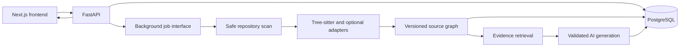

# Unfog 2.0 architecture

## System boundaries

- **Web:** Next.js, React, and TypeScript. Use native CSS, CSS Modules, and
  shared CSS variables. React Flow (`@xyflow/react`) is the planned graph
  renderer; Monaco is the planned read-only code editor.
- **API and orchestration:** Python + FastAPI with Pydantic. Repository
  scanning, indexing, retrieval, and learning orchestration remain Python-owned.
- **Persistence:** PostgreSQL is the recommended baseline, with SQLAlchemy 2 and
  Alembic. pgvector is deferred until semantic retrieval needs it.
- **Identifiers:** use Python-generated UUIDv4 for every persistent entity,
  SQLAlchemy UUID-compatible types that map to PostgreSQL's native `UUID`, and
  the same UUID values across primary keys, API schemas, and foreign keys. Use
  `created_at` for chronological ordering; do not depend on UUID sort order.
- **Background work:** Redis + Celery are planned for long-running indexing
  after the relevant infrastructure ticket. A simpler queue is acceptable if
  retries and tests are retained.
- **Parsing:** Tree-sitter Python bindings provide syntax structure, not full
  program semantics. An optional TypeScript language-service or SCIP adapter
  may improve cross-file resolution when available; Python owns orchestration.
- **Runtime models:** use a provider-agnostic interface with explicit privacy
  controls, budgets, validation, and traceability. The coding agent's model is
  independent of a user's runtime model choice.

Optional infrastructure is not part of the P0-01 scaffold and must be added by
an approved implementation ticket.

The current persistence slice contains users, repositories, snapshots, and
jobs with an initial Alembic migration. It does not yet include source-file,
symbol, edge, citation, or learning tables; those depend on later indexing and
learning contracts.

## Processing flow

The detailed target pipeline is in [PHASE_PLAN.md](PHASE_PLAN.md). The P0
scaffold does not yet implement this runtime flow.

## Repository evidence and provenance

Core records are scoped to a repository snapshot: repository, immutable
snapshot, normalized source file, symbol, source edge, citation, feature region,
learning goal, journey, challenge, attempt, mastery evidence, and changeset.
The phase plan describes the target logical schema; exact API and DB contracts
must be approved in their own tickets before implementation.

Use explicit evidence labels:

- `static_verified`: supported by syntax extraction or a language indexer.
- `runtime_verified`: observed in a separately authorized, isolated runtime
  execution with trace evidence.
- `ai_inferred`: model-suggested, source-supported interpretation not proven by
  static or runtime evidence.
- `unknown`: unresolved or insufficiently supported.

Confidence is optional metadata and cannot promote an inference to a verified
fact. A citation includes snapshot ID, canonical path, start and end lines, and
content hash. Validate that the referenced text exists in that snapshot. Never
join graph edges or citations across snapshots implicitly.

## Trust, privacy, and access

- Treat all imported files and repository documentation as untrusted input and
  possible prompt injection.
- Default to read-only parsing. Never run package hooks or user scripts during
  upload or indexing.
- ZIP ingestion must reject traversal and symlink escapes and enforce archive,
  file-count, file-size, and decompression limits.
- Remote Git access requires allowlisted schemes, SSRF defenses, bounded
  resources, and isolation from ambient credentials.
- Scope every source, graph, embedding, and generated-artifact query by project
  ownership and snapshot. Define deletion behavior before persistence is
  introduced.
- Exclude or redact secrets and sensitive source before model egress; keep raw
  source snippets and credentials out of logs.
- External model calls require explicit privacy controls. Project-local
  analysis should remain available when a provider is unavailable.
- Any future code execution or modification flow requires explicit consent,
  resource/network controls, and an isolated sandbox.

## Deferred decisions

Authentication provider, exact snapshot storage, database schema, queue
implementation, embedding provider, semantic-index adapter, and source-retention
implementation remain ticket-level decisions. Do not resolve them by adding
unrequested services or changing shared contracts outside an approved ticket.
