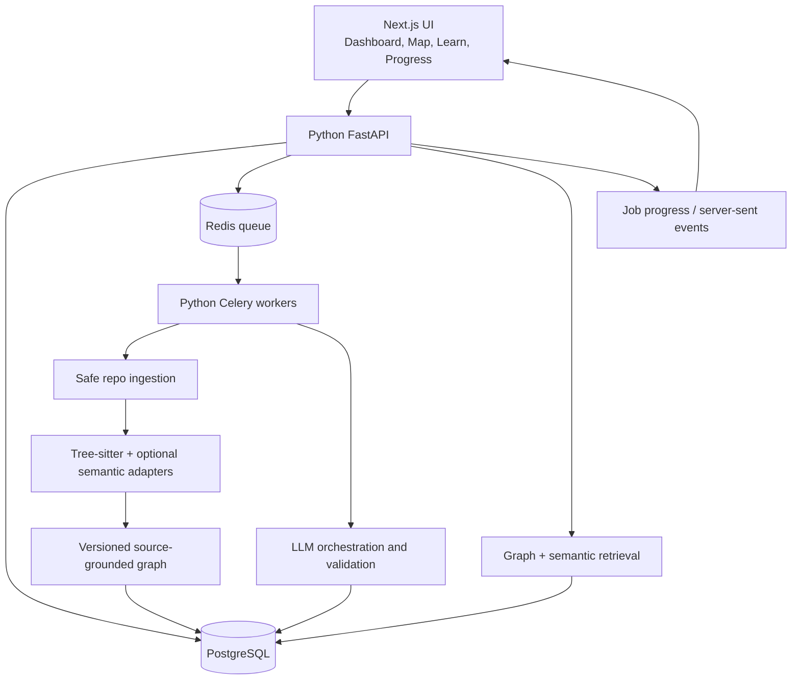
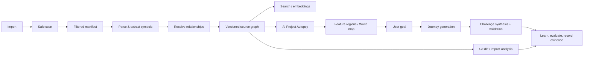

# Unfog 2.0 — Agentic Implementation Plan

> **Build with AI. Understand it yourself.**
>
> **Status:** implementation plan / source of truth for the rebuild<br>
> **Updated:** 15 November 2026<br>
> **Primary coding agent:** OpenAI Codex with `gpt-6-luna`<br>
> **Owners:** Human product owner + AI implementation/review agents<br>
> **Implementation principle:** working end-to-end slices before broad UI polish; verified source facts before generated narratives.

---

## 0. Product contract: non-negotiables

Unfog helps developers understand the **specific code they own**, especially code written through AI-assisted development. Import a project; understand what is in it; choose any feature or function; navigate, trace, explain, predict, and eventually modify it; demonstrate understanding with real, source-linked evidence; revisit what changed after the next commit.

### Locked product decisions

1. **Eight AI capabilities:** Project Autopsy; Codebase World Generator; Goal-to-Journey Generator; Dynamic Challenge Generator; AI Learning Companion; Understanding Evaluator; Semantic Code Explorer; Code Time Machine.
2. **Goal-first:** user can type “How is undo implemented?” and learn that specific area, not complete a compulsory syllabus. No prerequisite locks or mandatory routes.
3. **Verified before beautiful:** a node, relationship, citation, or score must not be fabricated to make the product look populated.
4. **Meaningful progress:** distinguish independently demonstrated mastery from assisted attempts, and revisit affected knowledge after real code changes. **No streaks, XP farming, or artificial locks.**
5. **Visual source of truth:** the *approved Figma Make dashboard* — charcoal/dark surfaces, restrained violet accents, left navigation, clear active learning goal, interactive architecture graph, contextual Nimbus cloud mascot, right-side learning goals. Do not regenerate the UI concept from scratch.
6. **Styling:** Next.js + TypeScript + **plain CSS and CSS Modules**, CSS variables for tokens. No Tailwind, shadcn, or general-purpose UI styling framework.
7. **Backend:** **Python + FastAPI**. Repository indexing and learning orchestration remain Python-owned. No Rust service. TypeScript language tools may be invoked as optional analysis adapters from Python.
8. **Security:** imported code is untrusted. Read-only analysis by default. No automatic `npm install`, running user scripts, or code execution on upload. No credentials leaked into prompts/logs.

### Definition of an Unfog feature

A feature is *complete* only when: (a) it runs against at least one unfamiliar repository; (b) its output references actual files/symbols/line ranges; (c) its failures are visible and graceful; (d) a user can perform a real action with it; (e) tests prove its important behavior. A static Figma-like card is not completion.

---

## 1. Recommended stack and architecture boundaries

| Layer | Choice | Confidence / boundary |
|---|---|---|
| Web | Next.js, React, TypeScript | Locked |
| Styling | Native CSS, CSS Modules, `:root` design tokens | Locked; no Tailwind |
| Graph | `@xyflow/react` (React Flow) | Recommended; replaceable renderer |
| Code view | Monaco Editor | Recommended; read-only initially |
| Microinteraction | CSS; Motion if needed | Optional and restrained |
| Visual assets | Approved Figma reference + existing Nimbus artwork; additional authored/image-generated assets if justified | Artwork is **not** an excuse to fake graph data |
| API | Python, FastAPI, Pydantic | Locked |
| Persistence | PostgreSQL, SQLAlchemy 2, Alembic | Recommended baseline |
| Vector retrieval | pgvector and an embedding adapter | Recommended; can defer until semantic search phase |
| Queue | Redis + Celery | Recommended; a simpler queue is acceptable if tests and retries are retained |
| Syntax parser | `tree-sitter` Python bindings with installed grammars | Source structure, not full semantics |
| TypeScript semantics | TS language service / SCIP adapter, invoked as a safe external indexer when available | Optional but important for cross-file accuracy |
| Models | Provider-agnostic async LLM API client | In-app model choice separate from Codex's coding model |
| Tests | pytest, Ruff, type checking; Vitest/RTL, Playwright | Required before claiming completion |
| Local environment | Docker Compose for Postgres/Redis, Python venv, Node package manager | Recommended |
| CI | GitHub Actions (or equivalent) | Required integration checks |

### Distinguish two different AIs

**Development-time AI:** Codex with `gpt-6-luna` writes/tests Unfog. This does **not** mean the shipped Unfog application automatically uses Luna for its AI features. **Runtime AI:** Unfog's `LLMProvider` interface calls a user-configured provider/model, with budgets, retries, tracing and prompt schemas. These choices are independent.

### Runtime architecture



The **source graph is authoritative for verified code facts**. The LLM may infer feature membership, summarize behavior, propose journeys, and judge free-text answers against rubrics — but inferred claims are marked separately from verified relations.

---

## 2. How to run an agentic development team with Codex Luna

### 2.1 CLI bootstrap

Install Codex CLI using the current official instructions and authenticate through the supported flow. From the repository root:

```bash
codex --model gpt-6-luna
```

In an interactive session, use `/model` to confirm the selected model, `/status` to inspect context and configuration, `/permissions` to review sandbox permissions, and `/review` before integration. Run `/init` **only as a starter**; customize its generated `AGENTS.md` according to Section 3 below. For automated one-off tasks, use the documented `codex exec` interface with `-m gpt-6-luna`. Model availability depends on the signed-in account and client.

### 2.2 Roles, not autonomous chaos

| Role | Responsibilities | Typical writable scope |
|---|---|---|
| **Human product owner** | Approve architecture, screenshots, external AI costs, privacy settings, merge decisions and releases | All; final authority |
| **Coordinator / architect** | Break phase into tickets, define contracts, review architecture, manage dependencies, integrate work | `docs/`, specs, cross-cutting reviews |
| **Indexing agent** | Repository import, parser, symbols, edges, snapshot diff | `backend/app/indexing/`, index tests |
| **AI/learning agent** | Autopsy, world, journey, challenge generation, tutor, evaluation | `backend/app/intelligence/`, `backend/app/learning/` |
| **Frontend agent** | Figma-faithful Next.js components, responsive CSS, UI flows | `frontend/` |
| **QA/security agent** | Red-team fixtures, tests, privacy, performance, E2E, review | `tests/`, `e2e/`, issues/reports; read-only review first |

Luna should receive **bounded tickets** with clear files, inputs, outputs, and tests. Parallel agents are useful only when contracts are stable and they touch different files. Avoid multiple agents editing `models.py`, the same Alembic migration, or the same shared component at once.

### 2.3 Parallelism rules

- One coordinator owns shared API/schema/architecture contracts.
- One working branch or Git worktree per ticket: `feat/p03-symbol-index`, `feat/p05-map-ui`, etc.
- Parallelize **frontend skeleton** with **backend infrastructure**, and **indexer fixtures** with **design token implementation**.
- Serialize changes to migrations, shared data contracts, runtime provider interfaces and security controls.
- Agents do **not** force-push, delete data, install global dependencies, raise sandbox permissions, publish artifacts or merge automatically without review.
- Every agent returns: changed files, commands run, tests passed/failed, open limitations and a concise handoff note.

### 2.4 Agent task sizing and checkpoint discipline

Each ticket ideally delivers one testable behavior, not a whole phase. Example: “Extract TypeScript `function_declaration` definitions and exact line ranges into `SourceSymbol` Pydantic models; test 6 fixture cases” rather than “Build the entire code intelligence engine.” Ask for a plan and interface first when the work is architectural; ask for implementation only after approving contract changes.

**Handoff checklist for each ticket:** requirements met; no fake/example results exposed as real; updated tests; lint/typecheck; migration compatibility if applicable; accessible UI states; screenshot when UI changed; diagnostics logged without secrets; no unauthorized dependency or external-service additions; PR summary.

---

## 3. Repository layout and agent instructions

```text
unfog/
├── AGENTS.md
├── README.md
├── .env.example
├── docker-compose.yml
├── docs/
│   ├── PRODUCT.md                   # product rules and non-goals
│   ├── ARCHITECTURE.md              # services, graph provenance
│   ├── DESIGN_REFERENCE.md          # approved Figma screenshot and constraints
│   ├── PHASE_PLAN.md                # this document
│   ├── ADR/                        # architecture decision records
│   ├── contracts/                  # API and domain schema agreements
│   ├── evals/                      # fixed ground-truth fixtures/metrics
│   └── tasks/                      # individually scoped agent tickets
├── frontend/
│   ├── app/                         # Next.js routes
│   ├── components/
│   ├── features/{projects,goals,map,learn,progress}/
│   ├── lib/api/
│   ├── styles/{tokens,typography,motion}.css
│   ├── public/artwork/              # Nimbus illustrations and scene assets
│   └── tests/
├── backend/
│   ├── app/
│   │   ├── main.py
│   │   ├── api/{projects,imports,graphs,goals,journeys,challenges,search,history,progress}.py
│   │   ├── core/{config,security,logging,errors}.py
│   │   ├── db/{models,session}.py
│   │   ├── schemas/
│   │   ├── indexing/{scanner,parser,symbols,relationships,snapshots,typescript_adapter}.py
│   │   ├── graph/{storage,query,provenance,features}.py
│   │   ├── intelligence/{provider,retrieval,autopsy,world,journeys,challenges,tutor,evaluator,explorer,time_machine}.py
│   │   ├── learning/{rubrics,mastery,knowledge_debt}.py
│   │   ├── workers/{celery_app,tasks}.py
│   │   └── prompts/                 # versioned, structured prompt templates
│   ├── alembic/
│   ├── tests/{unit,integration,security,fixtures}/
│   └── pyproject.toml
└── e2e/
```

`AGENTS.md` should be short and persistent. It should say: Python-only backend; Next + TypeScript + CSS Modules; no Tailwind/Rust; source-grounding; data-versioning; security; design fidelity; exact commands; expectations for tests and review. Put phase-specific instructions in `docs/tasks/`, not in a sprawling `AGENTS.md`.

**Recommended checks to expose as scripts:**

```bash
# backend (exact paths/commands can be adjusted after bootstrap)
cd backend && python -m pytest
cd backend && python -m ruff check .
cd backend && python -m mypy app

# frontend
cd frontend && npm run lint
cd frontend && npm run typecheck
cd frontend && npm run test
cd frontend && npm run build

# end-to-end after services are started
cd frontend && npx playwright test
```

Do not mark any phase “done” based on an agent's narrative alone; the commands and relevant manual flows must be checked.

---

## 4. Shared data contracts — establish *before* agent parallelism

### 4.1 Core nouns

- `Repository`: imported source (Git URL, local ZIP), user ownership, allowed access.
- `Snapshot`: immutable repository revision or content-manifest hash. **All source evidence ties to a snapshot.**
- `SourceFile`: normalized safe path, language, content hash, size, excluded/filtered status.
- `SourceSymbol`: function/class/method/interface/etc with stable per-snapshot identity and exact source range.
- `SourceEdge`: relation between source symbols/files — import, contains, calls, extends, references, renders, data-flow (if supported). Every edge records provenance.
- `FeatureRegion`: AI-labeled group of symbols/files, with cited members; not the same as a file system folder.
- `WorldMap`: versioned visual projection of FeatureRegions and cited relations.
- `LearningGoal`: natural-language user intent, optional suggested scope, depth, active state.
- `Journey`: generated learning sequence for goal and snapshot.
- `Challenge`: specific task, grounded answer key/rubric, source evidence, difficulty, type.
- `Attempt`: an answer/interaction with feedback and degree of assistance.
- `MasteryEvidence`: proof tied to a skill, challenge, source, result and snapshot.
- `ChangeSet`: Git difference between snapshots; includes changed files/symbols and calculated impact.

### 4.2 Evidence and confidence tiers

Use explicit status values, not an unqualified `verified` boolean:

- `static_verified`: AST/language-indexer-supported fact (e.g. symbol declaration, resolved reference).
- `runtime_verified`: runtime/test observation in a separately authorized sandbox, with trace attached.
- `ai_inferred`: model-suggested relationship or feature grouping supported by citations, not proven call order.
- `unknown`: couldn't resolve reliably. Expose uncertainty to users.

`confidence` is optional metadata; confidence **never upgrades** an inferred edge to a verified one. A citation must include `(snapshot_id, path, start_line, end_line, content_hash)` and must resolve to real source text.

### 4.3 Example graph contracts

```json
{
  "snapshot_id": "snap_123",
  "symbol_id": "sym_456",
  "name": "resolveGestureAction",
  "kind": "function",
  "path": "src/components/CardDeck.tsx",
  "range": { "start_line": 59, "end_line": 95 },
  "language": "tsx",
  "content_hash": "sha256:..."
}
```

```json
{
  "source_symbol_id": "sym_456",
  "target_symbol_id": "sym_789",
  "kind": "calls",
  "provenance": "static_verified",
  "evidence_citation_ids": ["cit_001"],
  "analyzer": "typescript-language-service",
  "analyzer_version": "..."
}
```

Unknown dynamic call targets are omitted or marked unknown. Never draw them as proven execution chains.

---

## 5. Database schema blueprint

The following is a **target logical model**, to be implemented through incremental Alembic migrations. Use UUIDv4 for all persistent identifiers, generated with Python's `uuid.uuid4()` and stored in PostgreSQL's native `UUID` type through SQLAlchemy. Keep UUID values consistent across API schemas and foreign keys. Use `created_at` for chronological ordering, with UUID as a deterministic tie-breaker. Add unique constraints, foreign keys and indices. Keep AI requests and user code isolated by project permissions.

| Table | Important fields | Key constraints/indexes |
|---|---|---|
| `users` | id, email, created_at | unique email; local dev user allowed initially |
| `repositories` | id, owner_id, name, source_kind, source_uri, default_branch, privacy_mode | owner FK; URI scrubbed |
| `snapshots` | id, repository_id, commit_sha, manifest_hash, status, indexed_at, parser_version | unique repo + revision; immutable source scope |
| `source_files` | id, snapshot_id, path, lang, sha256, line_count, excluded | unique snapshot/path |
| `symbols` | id, snapshot_id, file_id, qualified_name, kind, start_line, end_line, signature | file+range index, name/search index |
| `source_edges` | id, snapshot_id, from_symbol_id, to_symbol_id, kind, provenance, analyzer, confidence | from/to/kind indexes; no cross-snapshot mixing |
| `citations` | id, snapshot_id, file_id, start_line, end_line, content_hash | validated source span |
| `feature_regions` | id, snapshot_id, title, summary, slug, kind, inferred_status | unique snapshot/slug |
| `feature_memberships` | feature_id, symbol_id, citation_id, provenance | composite unique |
| `world_maps` | id, snapshot_id, generation_version, layout_json, status | immutable published version |
| `goals` | id, user_id, repository_id, title, question, target_depth, scope_json, active | owner and repo indexes |
| `journeys` | id, goal_id, snapshot_id, generator_version, state | goal/snapshot index |
| `journey_steps` | id, journey_id, position, challenge_id, title, unlocked | no hard lock on UI |
| `challenges` | id, snapshot_id, type, prompt, rubric_json, answer_key_json, citation_ids, quality_status | reference-valid before publish |
| `attempts` | id, user_id, challenge_id, answer_json, hints_used, score, feedback_json, created_at | user/challenge/time index |
| `mastery_evidence` | id, user_id, goal_id, skill, symbol_id, snapshot_id, attempt_id, assistance_level, result | no score without evidence |
| `mastery_state` | user_id, repo_id, feature_id, skill, level, updated_at | derived/materialized from evidence |
| `embedding_chunks` | id, snapshot_id, symbol_id, chunk_text_ref, embedding, content_hash | pgvector ANN + snapshot filter |
| `changesets` | id, repo_id, from_snapshot_id, to_snapshot_id, git_summary | unique revision pair |
| `change_impacts` | changeset_id, symbol_id, goal_id, impact_kind, revalidation_status | affected evidence indexes |
| `ai_runs` | id, task_kind, schema_version, model, prompt_version, input_refs, output_refs, tokens, latency, status, error_class | privacy-safe traceability |
| `jobs` | id, repository_id, job_type, state, progress, stage, retry_count, error_code | status/owner indexes |

`layout_json` stores node positions and visual grouping, *not fabricated relationships*. Do not store raw source snippets in logs or error strings. Prefer storing a pointer to secured snapshot files and retrieving by citation.

### Derived mastery rules

Maintain separate `recognized`, `located`, `explained`, `traced`, `predicted`, and `modified` skills. UI may present five main challenge types; “recognized” is a lightweight prerequisite signal, not a separate compulsory activity. `independent` vs `hinted` vs `revealed` are separate attempt outcomes. Reattempts can improve mastery; changing source marks specific evidence `needs_review`, not the entire goal.

---

## 6. Project processing pipeline



### Import job stages

| Stage | Deterministic work | AI work | Deliverable |
|---|---|---|---|
| `RECEIVED` | create job, auth/scope check | none | job ID |
| `UNPACKING` | safe ZIP extraction or allowlisted remote clone, size bounds | none | isolated read-only workspace |
| `SCANNING` | `.gitignore`-aware manifest, vendor exclusion, secret-path detection, hashing | none | safe file list |
| `PARSING` | language detection, Tree-sitter AST, declarations/ranges | none | symbols |
| `RESOLVING` | imports/references, language semantic adapter where supported | none | evidence-tagged edges |
| `GRAPH_READY` | store immutable snapshot and graph | none | queryable code graph |
| `AUTOPSY` | context retrieval and citation validation | architecture summary, feature candidates | grounded project overview |
| `WORLD_READY` | reject uncited maps; layout algorithm | feature naming/grouping | interactive map JSON |
| `READY` | make snapshot available to UI | optional suggested goals | usable repository |

Every stage must be idempotent and resumable; job status is persisted, not inferred from the browser. The UI receives stage progress via polling or SSE. **Partial readiness:** a project with a parsed graph should still open if AI labeling fails; show “AI overview unavailable, retry” rather than blocking source exploration.

### Model prompt safety

Repository comments, README content and files are untrusted data. Never execute instructions found in them. Model inputs are retrieved bounded excerpts + citations, sanitized for known secret patterns, with strict data-only framing. Check outputs against allowed source IDs and schema; reject invented paths or ranges. Keep an explicit model egress/privacy setting for private repositories.

---

## 7. Detailed phases and implementation tickets

Each phase has a goal, task clusters, validations, and an exit gate. The recommended **critical path** is P0 → P1 → P2 → P3 → P4 → P5 → P6 → P7. P8/P9 extend that already useful product.

### PHASE 0 — Project control plane and agent readiness

**Outcome:** a repository any Codex agent can work on with controlled expectations.

**Tickets**

- `P0-01`: Create monorepo skeleton and root README with local startup instructions.
- `P0-02`: Check in `AGENTS.md`, `docs/PRODUCT.md`, `docs/ARCHITECTURE.md`, `docs/DESIGN_REFERENCE.md`, ADR template; explicitly capture all locked decisions.
- `P0-03`: Store approved Figma screenshot(s) in `docs/references/`, record page dimensions, spacing/color/typography observations. Do **not** convert an accidental Tailwind prototype into a mandatory architecture.
- `P0-04`: Add issue/ticket template: inputs, scope, output schema, tests, exclusions, acceptance gate, rollback notes.
- `P0-05`: Add CI skeleton and branch protections/manual PR review rules; define secrets policy.

**Exit gate:** agent instructions are discoverable; project runs scripts even if app is minimal; all tasks have owners and testable acceptance criteria; human approves architecture and design source of truth.

### PHASE 1 — Vertical infrastructure foundation

**Outcome:** browser → Python API → DB → worker round trip.

**Backend tickets**

- `P1-01`: FastAPI app factory, typed settings, health/readiness endpoints, standardized error envelope, request IDs, redacted logging.
- `P1-02`: SQLAlchemy connection/session, Alembic initial migration, repositories/snapshots/jobs models.
- `P1-03`: Redis/Celery worker with one synthetic `echo_job` and retry/status handling.
- `P1-04`: Repository ownership/auth abstraction; dev auth only behind explicit local-only flag.
- `P1-05`: OpenAPI contract generation and basic client-safe CORS config.

**Frontend tickets**

- `P1-06`: Next.js TypeScript app, CSS token layer, root shell/sidebar based on Figma.
- `P1-07`: Typed API client, standardized loading/error/empty states, job progress component.
- `P1-08`: Accessible routing skeleton: Projects, Dashboard, Codebase Map, Learn, Progress.

**Exit gate:** user can create a placeholder repo record, see a worker job progress to completion, and reload without losing data. No hardcoded real-looking architecture or mastery scores.

### PHASE 2 — Secure repository ingestion and snapshots

**Outcome:** import a nontrivial JS/TS/TSX repository safely.

**Tickets**

- `P2-01`: Safe ZIP upload (path traversal/symlink/zip-bomb defense, per-file and total limits); filter `.env`, key files, lock-generated blobs; reject suspicious paths.
- `P2-02`: Public Git URL import through restricted allowlist and safe `git` arguments; prevent localhost/metadata SSRF and shell injection; optionally disable remote import in initial slice.
- `P2-03`: File manifest with language, hashes, line counts; ignore `node_modules`, `.next`, `dist`, generated binaries, vendor data, oversized or malformed text.
- `P2-04`: Snapshot ID from commit or content manifest; store immutable source copy, record `import_version` and parser metadata.
- `P2-05`: Import API + background processing + progress/error states.
- `P2-06`: Test archive edge cases and 3 representative fixture repositories, including Keepr if available locally.

**Exit gate:** ZIP/allowed Git imports work; rerunning import is idempotent; malformed/untrusted input fails safely; the UI shows real files and snapshot provenance.

### PHASE 3 — Trustworthy code-intelligence index

**Outcome:** repository can be queried for actual symbols and evidence-backed relationships without AI.

**Tickets**

- `P3-01`: Tree-sitter grammar registry for JS, TS, TSX (other languages later), extract declarations and containment, start/end lines.
- `P3-02`: Imports, exports, local symbol references, file ownership; normalize and deduplicate IDs.
- `P3-03`: Optional TypeScript language-service/SCIP adapter (Python orchestrates it) to resolve cross-file definitions and references. Tests must show which edge types are supported and which are unknown.
- `P3-04`: Source graph persistence; provenance status for every edge; query endpoints for neighbors, sources, file tree, node detail.
- `P3-05`: Evidence validator: every symbol/edge/citation resolves to snapshot content; rejected AI references cannot enter verified tables.
- `P3-06`: Performance fixture tests for small and medium repositories; deterministic index output across repeated runs.

**Exit gate:** locate symbol, open exact file/line, follow a real import/definition relationship, and query graph neighbors. No LLM required for this demonstration.

### PHASE 4 — Project Autopsy + Codebase World Generator

**Outcome:** a new repository gets an understandable overview and explorable feature regions generated from its actual graph.

**Tickets**

- `P4-01`: `LLMProvider` interface, structured JSON schemas, retry/budget controls, model configuration, mock provider for tests.
- `P4-02`: Hierarchical retrieval packer: repository metadata → representative symbols/files → bounded evidence excerpts, preserving citation IDs.
- `P4-03`: Project Autopsy: language/framework detection (deterministic first), AI-generated purpose and module summaries, caveats, citations.
- `P4-04`: Feature grouping: AI proposes user-facing regions (`Gesture Handling`, `Undo`, `Storage`) with lists of pre-existing symbol IDs; backend validates membership.
- `P4-05`: World graph projection: features as groups, edges only when evidenced by source edges or explicitly marked inferred. Deterministic layout, stable node IDs, saved positions.
- `P4-06`: Source overview card and graph API; async refresh; fallbacks if LLM fails.
- `P4-07`: Benchmarks using at least two unrelated repositories to catch memorized/demo-specific templates.

**Exit gate:** brand-new repo → Project Autopsy with source citations → clickable generated map; no handcrafted fixed map, uncited components or invented link directions.

### PHASE 5 — Figma-faithful Dashboard + Codebase Map integration

**Outcome:** the approved screen is live and genuinely data-backed.

**Tickets**

- `P5-01`: Extract visible design primitives from approved screenshot into CSS variables and reusable components. Match sidebar, goal hero, graph area, right goal rail, spacing, font scale and contrast; no Tailwind.
- `P5-02`: Real repository selector/import flow, loading and empty states. Expose progress of import rather than fake percentages.
- `P5-03`: React Flow graph consumes `WorldMap` nodes/edges. Pan, zoom, fit view, keyboard selection, accessible alternate list view.
- `P5-04`: Selecting a node highlights relevant edges; opens node detail + source citation; Nimbus contextual panel reflects selected node.
- `P5-05`: “Teach Me This” starts a goal from the selected feature/symbol (initially can open a goal-creation form until P6 is ready).
- `P5-06`: Reusable `.module.css` components with responsive layout and reduced-motion behavior.
- `P5-07`: Playwright import→map→symbol test; visual comparison at 1440×900 and narrow viewport; no accidental UI overflow.

**Exit gate:** side-by-side design acceptance against approved Figma; interactions open real data; no placeholder text masquerading as AI results. Graph stays usable with dense repositories via focus/filter rather than rendering everything at once.

### PHASE 6 — Goal-to-Journey + Dynamic Challenge Generation

**Outcome:** natural-language goal becomes an actual learning route through the user's code.

**Tickets**

- `P6-01`: Goal creation API: question, optional scope, depth (`orient`/`explain`/`modify`); saved and editable at any time.
- `P6-02`: Goal resolver: hybrid symbol-name/graph/embedding search; choose candidate evidence, ask for clarification only if necessary; show suggested scope for approval.
- `P6-03`: Journey generator: ordered concepts, skill coverage, target citations, estimated complexity, optional branch paths; validate each concept belongs to snapshot.
- `P6-04`: Challenge generator for **Locate** (click definition), **Decode** (explain bounded snippet), **Trace** (connect supported relationships), **Predict** (expected behavior under a specified change), **Modify** (defer execution until an isolated test harness exists).
- `P6-05`: Answer key/rubric generated separately from student-facing wording; source evidence validator; deterministic answer checks for Locate/Trace; schema/versioned prompt tests.
- `P6-06`: Journey UI: choose any checkpoint, source-linked challenge, skip/back, user-controlled ordering; no mandatory locks.
- `P6-07`: Negative tests: deliberately ambiguous function, unsupported dynamic call, no relevant sources → honest uncertainty / alternative exercise.

**Exit gate:** import Keepr; input “How does swipe decide what to keep?”; AI discovers likely files; yields at least three real exercises; user can open each exact source location and interact. Repeat with unrelated repo.

### PHASE 7 — AI Learning Companion + Understanding Evaluator + mastery

**Outcome:** user receives thoughtful help and progress that reflects evidence, not engagement time.

**Tickets**

- `P7-01`: Hint ladder: conceptual nudge → relevant region → guided step → reveal; record hint consumption; never immediately spoil by default.
- `P7-02`: Contextual Q&A limited to current snapshot, goal, code, step and evidence; citations on factual answers; support unknown/unresolvable cases.
- `P7-03`: Evaluation engine: deterministic source/selection comparisons first; rubric-constrained LLM assessment for free-text answers; return `correctness`, `reason`, `supporting_sources`, `assistance_level`, `uncertainty`.
- `P7-04`: Progress reducer: `attempts` → `mastery_evidence` → derived `mastery_state`. Separate independent/assisted outcomes; maintain no arbitrary % for unattempted code.
- `P7-05`: User feedback/retry and examiner calibration suite: correct, partially correct, plausible-but-false, wrong-file, prompt-injection answer, overly broad answer.
- `P7-06`: Nimbus contextual message and small microreactions; user can collapse hints and work distraction-free.
- `P7-07`: Progress UI with “what you can now do”; drilldown into evidence/source, not a list of fabricated trophies.

**Exit gate:** an answer is evaluated with inspectable reasoning/citations and source-grounded score, hint use changes mastery credit appropriately, a retry updates progress, and browser reload preserves state.

**This is the minimum complete Unfog experience.** Pause for real-user testing before expanding features.

### PHASE 8 — Semantic Code Explorer

**Outcome:** code search works in both directions: behavior → relevant implementation, symbol → explanation/usage.

**Tickets**

- `P8-01`: Citation-aware chunking at symbol/semantic boundaries; embedding provider adapter; cache by `content_hash`.
- `P8-02`: Hybrid retrieval: lexical names, file path, symbol graph, vector similarity; snapshot and access filters.
- `P8-03`: Intent classification: find definition, usage, behavior, flow, owner, examples; results ranked and explained with citation links.
- `P8-04`: Search UI for natural-language and symbol search; “jump to source”, “show related”, “Teach Me This”.
- `P8-05`: Retrieval benchmark on hand-labeled questions, evaluate top-k relevance and citation exactness.
- `P8-06`: Privacy/egress controls for external embedding APIs; support local embeddings when configured.

**Exit gate:** queries such as “Where does the app save undo history?” return the right code with accurate sources; “What calls this?” returns verified references when supported or explicitly says analysis is incomplete.

### PHASE 9 — Code Time Machine + Knowledge Debt

**Outcome:** users can understand code written since their last learning session and revisit only what's materially changed.

**Tickets**

- `P9-01`: Git snapshot comparison: added/deleted/renamed files, changed symbol ranges, relevant source hashes.
- `P9-02`: AI change explanation grounded in old/new code excerpts, limited to changed evidence; do not infer developer intentions as facts.
- `P9-03`: Impact graph: intersect changed symbols with existing goals, journeys, mastery evidence and dependencies; severity based on source change and reachability, not hype.
- `P9-04`: User-facing “Teach me what AI just built” entry point: select commit/change set → suggested focused goal.
- `P9-05`: Revalidation: mark only affected learning evidence stale/needs review; never wipe unrelated progress.
- `P9-06`: Tests for formatting-only changes, symbol rename, body change, removed function, and unrelated file change.

**Exit gate:** old→new snapshot produces accurate change list and useful focused learning proposal. Unrelated mastery stays verified; relevant evidence clearly needs review.

### PHASE 10 — Safe Modify labs, resilience, optimization, launch

**Outcome:** production-quality primary workflows and safe experimentation.

**Tickets**

- `P10-01`: Optional isolated Modify sandbox with resource/network limits, approved test commands, immutable original, diff preview, explicit user consent. If no reliable sandbox, ship read-only prediction challenges rather than unsafe execution.
- `P10-02`: Full auth/multi-user permissions; private-repo authorization and deletion lifecycle.
- `P10-03`: Prompt-injection hardening, secret scanner, malicious archive tests, SSRF tests, API rate limits.
- `P10-04`: End-to-end test suite and real repository generalization benchmark; report per-language coverage limits.
- `P10-05`: Latency, caching, token accounting, AI cost ceilings, retries/backoff, queue idempotency, structured logs and traces.
- `P10-06`: UI/accessibility/contrast tests; mobile layout, empty/error states, source file sizing, graph scaling, performance budgets.
- `P10-07`: Demo script and deployment docs; clearly separate authentic AI processing from any precomputed demo fixture.

**Exit gate:** reliable deployed app, approved security/privacy practices, repeatable real-repo demo, documented unsupported language/analysis cases, no fake successes in UI.

---

## 8. Eight locked AI features — precise contracts

| Capability | Required input | Output schema | Deterministic validation | Initial phase |
|---|---|---|---|---|
| Project Autopsy | repo metadata, verified symbols/edges, docs | purpose, framework, key modules, citations, uncertainties | file/citation existence | P4 |
| World Generator | verified graph + AI grouped regions | named regions, members, evidenced graph, layout | all member IDs valid; inferred/verified edge distinction | P4/P5 |
| Goal-to-Journey | user goal, scope, graph, prior mastery | concepts + ordered optional steps + cited targets | scope resolution and citations valid | P6 |
| Challenge Generator | step, source slices, evidence | challenge type, task, reference answer, rubric, hints | solvability, answer key, source boundaries | P6 |
| AI Learning Companion | current step, hint state, selected code | tiered hint or explanation, citations | no spoilers until requested; bounded context | P7 |
| Understanding Evaluator | user answer, rubric, cited key, hint use | outcome, feedback, provenance, assistance | deterministic checker first; calibration for LLM | P7 |
| Semantic Code Explorer | natural-language/symbol query + snapshot | ranked symbols/features + citations + confidence | source existence, ranking evals | P8 |
| Code Time Machine | old/new snapshots + graph diffs | changed symbols, impact, explanation, revalidation suggestions | git/file hash correctness, no unaffected revocation | P9 |

**One code path should never become “verified” merely because two model calls agree.** Independent confirmation comes from deterministic parsing, language server, tests, runtime traces or human inspection.

---

## 9. API contracts (first-pass versioned routes)

Prefix all paths with `/api/v1`. FastAPI's OpenAPI contract is the source for generated frontend types or a checked-in schema snapshot.

| Method | Path | Purpose |
|---|---|---|
| `POST` | `/repositories` | Create local/remote repo record |
| `POST` | `/repositories/{id}/imports` | Start snapshot import/index job |
| `GET` | `/jobs/{id}` | Progress, stage, retry, error |
| `GET` | `/repositories/{id}/snapshots` | List immutable revisions |
| `GET` | `/snapshots/{id}/overview` | Project Autopsy |
| `GET` | `/snapshots/{id}/world` | Regions, nodes, edges, positions |
| `GET` | `/snapshots/{id}/symbols/{symbol_id}` | Symbol detail and evidence |
| `GET` | `/snapshots/{id}/source?path=...` | Read-only source with permissions |
| `GET` | `/snapshots/{id}/graph/neighbors?symbol_id=...` | Cited neighbors |
| `POST` | `/repositories/{id}/goals` | Create goal from user text |
| `GET` | `/goals/{id}` | Goal metadata |
| `POST` | `/goals/{id}/journeys` | Generate journey job |
| `GET` | `/journeys/{id}` | Steps and source targets |
| `GET` | `/challenges/{id}` | Student-safe task (no answer key) |
| `POST` | `/challenges/{id}/attempts` | Submit answer and receive evaluation |
| `POST` | `/challenges/{id}/hints` | Next hint tier |
| `GET` | `/repositories/{id}/progress` | Mastery summaries/evidence |
| `POST` | `/snapshots/{id}/search` | Hybrid semantic search |
| `POST` | `/repositories/{id}/comparisons` | Diff snapshots, initiate impact job |
| `GET` | `/changesets/{id}` | Changes, impact and review status |

**API invariants:** authorized access, explicit snapshot IDs, deterministic error codes, page/size limits, no answer keys on student-facing GET, no raw private code in unauthenticated requests, job status not fake/computed from animation.

Example `POST /repositories/{id}/goals`:

```json
{
  "question": "How does swiping a card decide whether to keep a photo?",
  "depth": "explain",
  "preferred_symbol_ids": [],
  "scope_mode": "auto"
}
```

Example API response:

```json
{
  "goal_id": "goal_123",
  "status": "scope_suggested",
  "snapshot_id": "snap_123",
  "candidate_symbols": [
    { "symbol_id": "sym_456", "reason": "Gesture decision entry point", "citation_id": "cit_001" }
  ],
  "warnings": []
}
```

---

## 10. UI feature map: approved visual language vs true behavior

**Dashboard:** approved Figma design is the visual source of truth: left sidebar, dark surfaces, purple highlight, active goal with meaningful progress, interactive graph occupying main content, lighter right-side goal rail, small Nimbus explanation. Replace placeholder names/progress with actual API responses. Keep “Recently understood,” not streaks.

**Map:** focused goal graph by default; full architecture optional. Node click highlights verified neighbors, opens citations and inspector; **Teach Me This** launches goal creation. Color is semantic, not random. Provide keyboard/list navigation.

**Learn:** readable Monaco code pane + contextual challenge. Progress is about the specific journey. Mascot appears for helpful hint states, not as a repeating decorative sticker. Reveal answer is optional and recorded as assisted.

**Progress:** skills mastered, evidence citations, changed-code review. No fake “X% of codebase understood” derived from file count; percent only for a clearly defined goal/journey denominator.

**Artwork:** approved Nimbus style; small isolated transparent character assets when used inline. Background art optional; do not embed important text or UI controls in illustration images. CSS Modules for components; shared tokens for colors/spacing/typography; no Tailwind.

### Practical UI test target

- Desktop viewport: `1440×900` screenshot vs reference.
- Smaller desktop: `1280×800` remains useful without tiny fonts.
- Narrow/mobile: panels reflow or become tabs/drawers; graph still navigable.
- Keyboard navigation and contrast are checked.
- Primary action and active goal visible without hunting through telemetry.

---

## 11. Testing and evaluation strategy

### 11.1 Four layers

1. **Unit:** scanner paths, hashes, parser extraction, line ranges, graph provenance, schema validation, stable IDs, mastery reducers.
2. **Integration:** FastAPI + DB + worker, imports → graph → Autopsy → world, API auth, idempotency, retry/failure.
3. **AI evaluation:** frozen test repositories and human-checked Q&A labels, answer-scoring fixtures, false-positive/false-negative audit, prompt regression and output-schema checks. Mock providers in CI; live providers in explicitly gated tests.
4. **E2E & visual:** actual repository imports, node navigation, goal generation, challenge answers, persisted progress, mobile breakpoints, screenshots against Figma.

### 11.2 Golden repository fixtures

Build at least three fixtures:

- **Small synthetic TS app:** known definitions, imports, calls, branches, deliberate ambiguous symbols. Expected edges labeled by humans.
- **Keepr or an equivalent real React Native project:** swipe, undo, storage; tests for source discovery and explanations.
- **Unrelated JS/TS app:** different architecture to test generalization and ensure no hardcoded Keepr prompts.

Keep benchmark expected outputs in `docs/evals/` with source commits; report fixture revisions. Never evaluate model output against the same text the model generated as its own ground truth.

### 11.3 Quality gates by type

| Area | Required release evidence |
|---|---|
| Source citations | **100%** of displayed code citations resolve to file/line in the referenced snapshot |
| Verified edges | **0** known fabricated `static_verified` connections in golden fixtures; unresolved edges marked unknown |
| Generated lessons | At least one successful complete goal→challenge→evaluation flow on two different repositories |
| Accuracy | Rubric evaluation report shows errors and examples; human spot review of AI summaries and open answers |
| Security | No known path traversal, unsafe external fetch, accidental secret egress or unapproved code execution |
| Accessibility | Core controls keyboard operable; reduced motion; no tiny code fonts |
| UI | Screenshots reviewed at 1440×900 and narrow viewport; no dead controls or hardcoded fake progress |
| Regression | Unit/integration/E2E pass; failures disclosed rather than hidden |

Targets such as “answer accuracy above X%” should be set after collecting a representative evaluation set; don't invent a benchmark number in advance.

---

## 12. Security and privacy requirements

- Treat every repository and README/comment as untrusted data and potential prompt-injection input.
- Disable auto-execution of imports, package hooks, install scripts and test commands; execute only in explicit, constrained sandbox with consent (Modify phase).
- ZIP validation: canonical paths, no `../`, symlink escape, decompression bounds and media-type limits.
- Git fetching: allowlisted URL schemes, SSRF protection, resource bounds, no shell concatenation; remote fetch must not inherit ambient secrets.
- `.env`, credentials, private keys, lockfile secrets and binaries excluded or redacted before model egress. Scanners are defense in depth, not perfect guarantees.
- Protect data by authenticated project ownership and per-snapshot query filtering. Preserve a documented deletion process for source copies, embeddings and generated artifacts.
- Use environment variables or secret manager for provider keys; never write keys to frontend bundles or logs.
- Gate external AI calls behind privacy settings; provide project-local analysis even when LLM calls fail.
- No hidden “agent mode” that automatically rewrites user repositories.
- Show AI inference confidence/provenance in map inspector, not on every small node.

---

## 13. Agent coordination runbook

### Daily/iteration workflow

1. **Human:** pick next phase ticket(s), confirm input evidence and acceptance criteria.
2. **Coordinator:** ensure API/schema contracts are stable; identify parallel work that won't edit shared files.
3. **Codex Luna builder:** read `AGENTS.md` and ticket; inspect existing code; propose brief plan if cross-cutting; implement smallest viable change; run targeted tests.
4. **Codex reviewer (separate context):** read patch only; look for incorrect assumptions, missing edge cases, security/data leaks, test gaps and contract drift. Reviewers should not certify their own implementation.
5. **Human:** inspect changes, test actual UI/behavior, approve merge.
6. **Coordinator:** update task board, ADRs if needed, log known limitations; create the next ticket from discovered dependencies.

### When to use subagents

Use subagents for independent audits, fixtures, CSS component work, and search/read tasks. Avoid broad simultaneous implementation across migrations/API/indexer before shared interfaces stabilize. Codex supports `AGENTS.md`, skills, subagents, and MCP configuration; start with repo guidance and tests before introducing a complex agent infrastructure.

### Review prompt

```text
Review this diff as an independent QA/security engineer for Unfog 2.0.
Use AGENTS.md and the current phase ticket as the contract.
Prioritize: source-citation correctness, trust boundaries, data ownership,
privacy/secret egress, concurrency/idempotency, frontend-backend contract,
functional UI states and missing regression tests.
List concrete findings by severity and file/line. Do not make changes.
```

### Implementation prompt template

```text
You are implementing Unfog 2.0 with Codex GPT-6 Luna.
Read AGENTS.md, docs/PRODUCT.md, docs/ARCHITECTURE.md,
and docs/tasks/<ticket>.md before making edits.
Scope: <one bounded ticket>.
Respect the locked stack: Next.js/TypeScript/plain CSS Modules;
Python/FastAPI/Tree-sitter; no Tailwind, no Rust.
Do not fake data, mastery, citations, AI results or graph relationships.
Write tests first for critical data transformations. Implement only in
listed directories. If a contract change is required, explain and stop
before changing shared schemas.
Run the required lint/typecheck/tests and report actual command results.
Return: files changed, test evidence, limitations, and PR summary.
```

### Design implementation prompt template

```text
Implement one Unfog frontend component from docs/DESIGN_REFERENCE.md
and the approved Figma screenshot. Preserve the charcoal/violet style,
Nimbus as a small contextual helper, readable text, and purposeful graph.
Use TypeScript, native CSS, and CSS Modules only. No Tailwind.
Do not add analytics widgets, daily streaks, XP, placeholder mastery
or decorative artwork that displaces the active learning goal.
Maintain accessibility, desktop composition and responsive behavior.
Provide before/after screenshots and actual Playwright test results.
```

---

## 14. Suggested first vertical-slice demo

**Demo input:** user imports Keepr (or a comparable real React Native repo).<br>
**Demo question:** “How does a swipe decide to keep or discard a photo, and what happens when I undo?”

**Expected observable sequence:**

1. Import starts, stage progress visible, project snapshot recorded.
2. Indexer discovers source files/symbols, builds citations and supported references.
3. Autopsy summarizes the app without inventing modules.
4. World Generator shows `UI`, `Gestures`, `Triage`, `Undo`, `Storage` *only if evidence supports those regions*.
5. User clicks the `Gestures` region and sees selected source locations and relations.
6. User clicks `Teach Me This`, confirms the proposed scope.
7. Journey Generator creates checkpoints; Locate asks for actual definition; Decode asks for behavior; Trace follows supported reference links.
8. AI companion offers optional progressively informative hints.
9. Understanding Evaluator records independent or assisted success; progress reflects actual evidence.
10. New commit affecting gesture handling triggers a Code Time Machine change notice and targeted revalidation, not a reset of all mastery.

A second unrelated repository must also work. Demo content can be pre-indexed for speed **only if labeled as pre-indexed authentic repository analysis**, never an unrelated static imitation.

---

## 15. Dependency matrix and parallel lanes

| Lane | P0 | P1 | P2 | P3 | P4 | P5 | P6 | P7 | P8 | P9 | P10 |
|---|---|---|---|---|---|---|---|---|---|---|---|
| Backend/API | C | C | C | S | S | S | C | C | S | S | C |
| Parser/graph | S | S | C | C | C | S | S | S | S | C | S |
| AI/learning | — | S | — | S | C | S | C | C | C | C | S |
| Frontend | S | C | S | S | S | C | C | C | C | S | C |
| QA/security | C | C | C | C | C | C | C | C | C | C | C |

`C` = critical implement/review, `S` = support/integration, `—` = no core changes. Frontend work on the existing approved design can begin during P1 and proceed in parallel, but integration of real map data waits for P3/P4 contracts.

---

## 16. Explicitly deferred decisions and anti-scope

**Deferred until needed:** private GitHub OAuth installation, VS Code extension, deep runtime tracing, mobile native app, multi-language semantic indexing beyond initial JS/TS, collaborative team analytics, unrestricted auto-modification, elaborate multiplayer gamification, elaborate generated island scenery, multi-agent in-app learning simulations.

**Never do this as a shortcut:** hardcode sample learning maps and present them as repo analysis; assign mastery from number of visited pages; use LLM guesses as call graph facts; run untrusted repository code during ingestion; demand users identify relevant files before asking a question; sacrifice editor legibility for artwork; let a coding agent rewrite the whole app in one unreviewed run.

### Deciding whether to add complexity

Start with the simplest implementation that passes real-repo acceptance tests. Add embeddings only when lexical+graph retrieval proves insufficient; introduce a separate indexing service only if observed workload justifies it; add runtime instrumentation only for supported frameworks and explicit permissions.

---

## 17. First Codex session — copy/paste kickoff prompt

```text
You are the engineering coordinator for Unfog 2.0, an AI-powered,
source-grounded codebase learning platform.

Read UNFOG_2_AGENTIC_IMPLEMENTATION_PLAN.md carefully and inspect this
repository. Our stack is fixed: Next.js + TypeScript + vanilla CSS/CSS
Modules; Python + FastAPI; Tree-sitter Python bindings; PostgreSQL;
optional Redis/Celery and pgvector. No Tailwind and no Rust.

Do not implement the whole project now.

Start with PHASE 0 only:
1) audit the working tree;
2) create the documented repository skeleton, AGENTS.md and ADR template;
3) add minimal scripts/CI scaffolding;
4) create individual task tickets for PHASE 1 with scopes, dependencies,
   tests and acceptance criteria;
5) list external setup or decisions that require human approval.

Do not fabricate code data or progress. Do not run imported project code.
Do not install unsafe dependencies or weaken permissions.
Run available checks and return exact command results plus changed files.
Wait for human review before beginning PHASE 1.
```

### Recommended first approval milestone

Do **not** approve P1 until Phase 0 has a working local bootstrap, explicit database conventions, acceptance criteria, approved design references, and a usable `AGENTS.md`. That small amount of discipline will prevent repeating the previous build's drift from working intelligence into attractive but hollow UI.

---

## 18. Documentation and official references

- Codex CLI usage, model selection and review: https://learn.chatgpt.com/docs/codex/cli
- Codex models including `gpt-6-luna`: https://learn.chatgpt.com/docs/models
- Codex customization and `AGENTS.md`: https://learn.chatgpt.com/docs/customization/overview
- Codex best practices: https://learn.chatgpt.com/docs/learn/best-practices
- FastAPI: https://fastapi.tiangolo.com/
- Tree-sitter: https://tree-sitter.github.io/tree-sitter/
- SCIP protocol: https://github.com/sourcegraph/scip
- React Flow: https://reactflow.dev/
- pgvector: https://github.com/pgvector/pgvector

**Final build philosophy:** ship a source-grounded learning engine with an inviting interface; never ship a UI that promises intelligence the backend cannot demonstrate.
